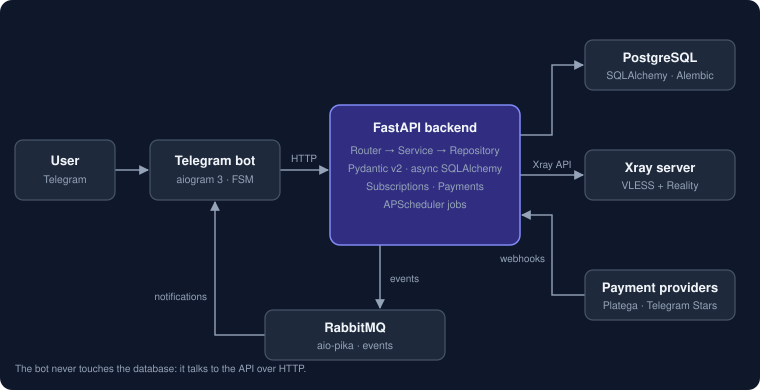

# Hi, I'm Nikita

**Junior Backend Engineer · Python**

I build backend systems in Python: async APIs, background-task pipelines, Telegram bots and data-collection automation. Two years of commercial experience, plus a production VPN platform I designed and built end to end (case study below).

I care about clear layering, explicit boundaries between services, and READMEs that explain *why* a decision was made, not just how to run the code.

---

## Experience

**Junior Python Developer** · DataStream
 April 2024 — April 2026

- Built asynchronous data-collection modules for the VK and Telegram APIs (`aiohttp`), enabling real-time ingestion without blocking
- Implemented a full-cycle ETL pipeline (extract, transform, load) with `pandas` and `SQLAlchemy`
- Developed a reporting microservice on FastAPI with OpenAPI/Swagger documentation
- Containerised applications with Docker and Docker Compose, automating and speeding up deployment (from 40 minutes to 5)
- Took part in migrating a monolith to a microservice architecture: service extraction and inter-service communication
- Worked with Celery + RabbitMQ task queues and Redis caching

Stack: Python · FastAPI · aiohttp · pandas · SQLAlchemy · Celery · RabbitMQ · Redis · Docker

---

## Tech Stack

| | |
|:--|:--|
| **Backend** | Python · FastAPI · SQLAlchemy 2.0 (async) · Pydantic v2 · Alembic |
| **Data & Queues** | PostgreSQL · Redis · RabbitMQ (aio-pika) · Celery |
| **Bots & Automation** | aiogram 3 · Telethon · Playwright · Selenium · aiohttp |
| **Infrastructure & Tools** | Docker · Docker Compose · Linux · Git · pytest |

---

## Engineering Focus

- Async-first backend development
- Clean Architecture and separation of concerns
- Event-driven communication
- Database design and optimization
- Reliable background job processing
- API design and integration
- Containerized deployments

---

## What I Build

**Async APIs and background processing**
- [deribitClient](https://github.com/kiselewb/deribitClient): FastAPI + Celery + Redis + PostgreSQL service that tracks crypto prices, with a documented layered architecture and tests
- [departmentAPI](https://github.com/kiselewb/departmentAPI): organisation-structure API with a recursive-CTE cycle check on tree moves

**Telegram bots and automation**
- [encarParser](https://github.com/kiselewb/encarParser): car-listing parser with a translation layer and an aiogram bot on top
- [wbParser](https://github.com/kiselewb/wbParser): Playwright + aiohttp scraper with a multi-mode CLI and XLSX reporting

---

## Featured Case: VPN Platform

<b>VPN platform with a Telegram bot</b>: the full subscription cycle, from payment to access (private repository)

 

A commercial VPN service covering the whole cycle. The user picks a plan in the bot, pays, and the subscription activates automatically. I designed and built the backend, the Telegram bot and the VPN server infrastructure from scratch. The code is private; the engineering is described here.

**What's implemented**

- **REST API on FastAPI** with a Router → Service → Repository architecture, dependency injection and strict Pydantic v2 validation
- **Multi-provider payments** (Payment providers, Cryptocurrency, Telegram Stars) behind a registry, interchangeable via Strategy + Registry; webhooks handled with Template Method and request authenticity checks
- **Subscription management**: activation, renewal, scheduled deactivation of expired subscriptions (APScheduler), and expiry reminders at 72, 48 and 24 hours through a message queue
- **Event-driven messaging** over RabbitMQ (aio-pika): producers and consumers for notifications and payment events decouple the API from the bot
- **Telegram bot on aiogram 3** with FSM flows; it never touches the database and talks to the API over HTTP
- **VPN infrastructure**: Xray on Debian 13, hardened with UFW and Fail2Ban, BBR enabled

**Engineering decisions**

- Async stack at every level, one DB session per request
- A single exception hierarchy with a global handler; business logic lives only in services
- Idempotent subscription model: one subscription per user, renewal only shifts the expiry date, the subscription token never changes
- Schema changes only through Alembic migrations

Python · FastAPI · SQLAlchemy 2.0 · asyncpg · PostgreSQL · Alembic · Pydantic v2 · RabbitMQ · aio-pika · aiogram 3 · httpx · APScheduler · Xray · Debian

---

## Contact

